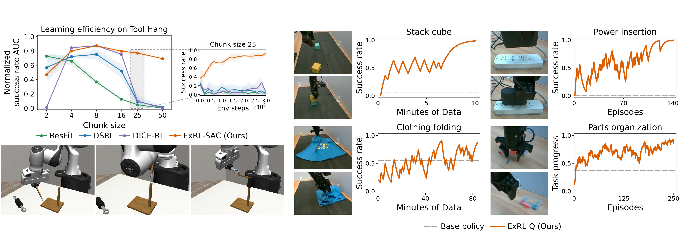

<div align="center">

# ExRL: Sample-Efficient Online Adaptation of Long-Chunk Policies via Execution Length Control

### [Website](https://exrl-project.github.io) &nbsp;&nbsp; [Paper](https://exrl-project.github.io/paper.pdf)

</div>

<p align="center">
  <a href="assets/teaser.png">
    
  </a>
</p>

## Overview

Adapting pretrained robot policies with reinforcement learning can require substantial interaction data, especially when long action chunks make the action space high-dimensional. ExRL addresses this challenge by learning **how long to execute each predicted action chunk before replanning**, enabling sample-efficient adaptation through a small discrete decision space. Across simulation and real robots, ExRL substantially improves success rates with limited interaction, including for π₀.₅ on contact-rich and long-horizon manipulation tasks.

## Getting started

```bash
git clone https://github.com/Frankluox/ExRL.git
cd ExRL
```

Choose a setup below. Each guide covers installation, data and base-policy preparation, ExRL training, evaluation, and the available baselines. For a first experiment, start with **DP on Robomimic Can**.

| Setup guide | Base policies |
| --- | --- |
| [Robomimic](docs/robomimic.md) | Diffusion Policy, ACT |
| [Adroit](docs/adroit.md) | Diffusion Policy |
| [LIBERO](docs/libero.md) | π₀, π₀.₅, π₀-FAST, Cosmos Policy |
| [Real robots](docs/real_robot.md) | Your action-chunked policy; includes a Piper/π₀.₅ example |

The [baseline guide](docs/baselines.md) describes the comparison methods and their supported configurations. See [code structure](docs/code.md) for implementation details and tests. Datasets and model weights are obtained separately.

## Tips for hyperparameter tuning

The shared defaults work well across most tasks; start with them before tuning.

- **Parallel environments.** When increasing `n_envs`, increase gradient updates proportionally to preserve the effective update-to-data ratio (UTD). The Robomimic launcher does this automatically, so keep the YAML `utd` fixed; see [UTD and parallelism](docs/robomimic.md#utd-and-parallelism).
- **Real-robot UTD.** A larger UTD can accelerate early learning, but may reduce final performance. Start from the task recipe and increase it only when faster initial adaptation is important.
- **Network width.** For more complex tasks, try hidden layers of width **1024 or 2048**.
- **Long-horizon tasks.** A discount factor of **0.999** often works better than the default 0.997 (`gamma` in Robomimic configs, `discount` in LIBERO and real-robot configs).

## Acknowledgements

We build on [DSRL](https://github.com/ajwagen/dsrl), [DPPO](https://github.com/irom-princeton/dppo), Robomimic, LeRobot, Stable-Baselines3, jaxrl2, OpenPI, and Cosmos Policy. See [THIRD_PARTY.md](THIRD_PARTY.md) for upstream sources and licenses.
